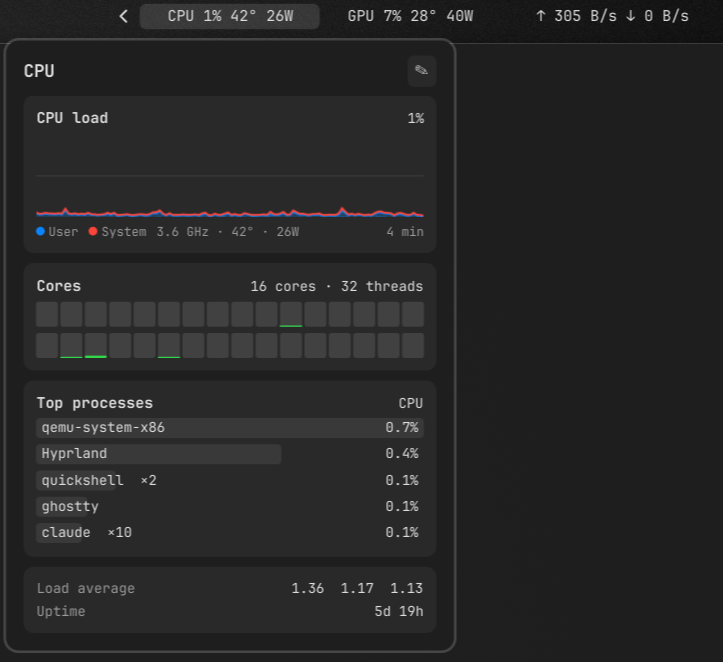
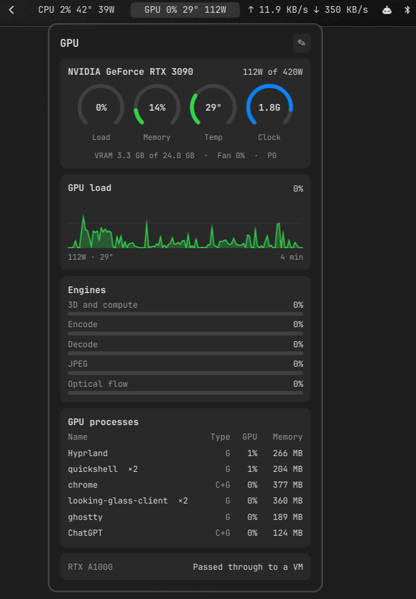
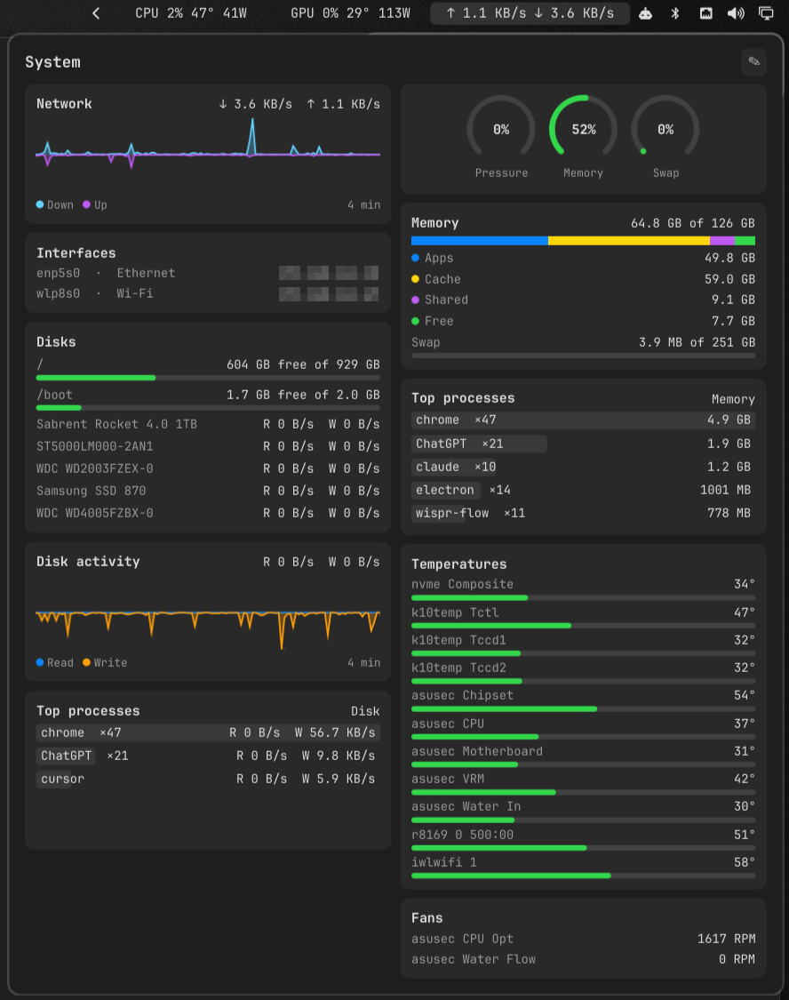
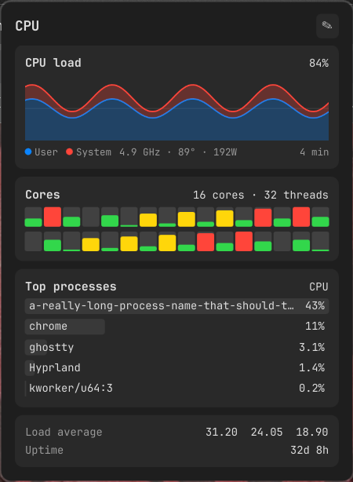
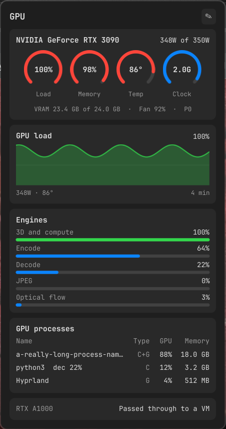
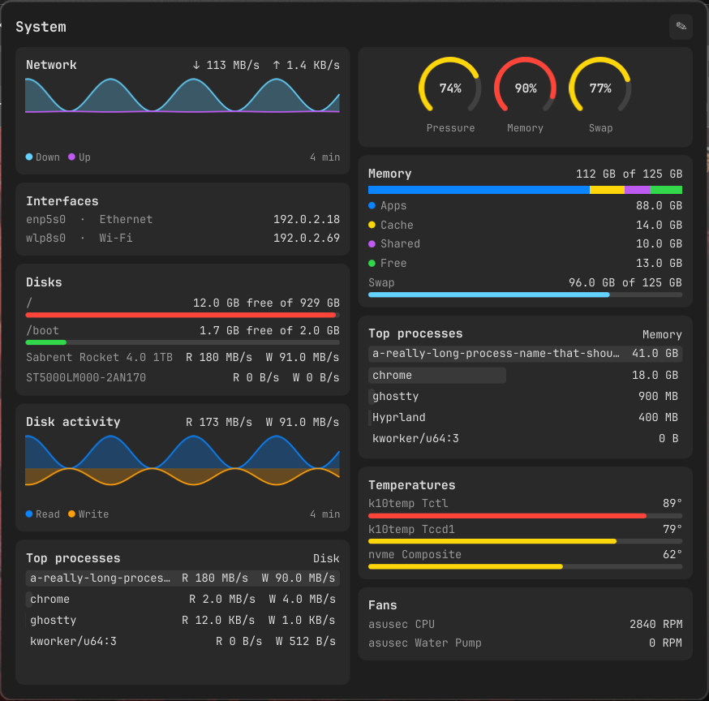

# OmaView

Live CPU, GPU and network stats in your [Omarchy](https://omarchy.org) bar. Hover a section for
a detailed report, then rearrange its cards however you like.

```text
CPU 41% 45° 120W    GPU 37% 29° 36W    ↑ 1.2 MB/s ↓ 8.4 MB/s
```

<p>
  
  
  
</p>

<sub>A real machine, mostly idle. IP addresses are blurred.</sub>

<details>
<summary>The same reports under heavy load</summary>
<br>
<p>
  
  
  
</p>
<sub>These use the built-in fake data, which pegs values on purpose.</sub>
</details>

> [!WARNING]
> **Made by AI — use at your own peril.** I've reviewed the code, but that doesn't make it
> bulletproof. Expect sharp edges.

## What you get

| Section | Bar shows | Report shows |
|---|---|---|
| **CPU** | Usage, temperature, power | Load graph, per-core load, top processes, load averages, uptime |
| **GPU** | Usage, temperature, power | Load, memory, temperature and clock; load graph; 3D and compute, encode, decode, JPEG and optical flow use; per-process list; GPUs passed through to a VM |
| **System** | Upload and download speed | Network and interfaces, disk space and activity, memory, swap, top processes, temperatures, fans |

## Requirements

- Omarchy with its Quickshell bar
- Python 3.11 or newer, with no extra packages and no build step
- A supported GPU for GPU data. Everything else works without one.

| GPU | Driver | Status |
|---|---|---|
| NVIDIA | Proprietary driver | Tested on an RTX 3090 |
| AMD | `amdgpu` | **Not validated** on real hardware |
| Intel Arc | `xe` or `i915` | **Not validated** on real hardware |

AMD and Intel support is written from the kernel's documentation and tested against simulated
files, because I don't have those cards. **If you do, a quick
[validation report](https://github.com/qnlbnsl/omaview/issues/new?template=gpu_validation.yml)
would be a big help**, even if everything looks right.

## Install

```bash
omarchy plugin add https://github.com/qnlbnsl/omaview.git --enable
```

To get a newer version later:

```bash
omarchy plugin update io.github.qnlbnsl.omaview
```

## Remove

To take it off the bar but keep it installed:

```bash
omarchy plugin disable io.github.qnlbnsl.omaview
```

To delete it:

```bash
omarchy plugin remove io.github.qnlbnsl.omaview
```

Either one also stops the collector and clears your report layouts and temperature unit, so
turning OmaView back on starts from the defaults. The empty socket and lock files in
`$XDG_RUNTIME_DIR` stay until you log out.

## Use

**Open a report:** rest the pointer on a section or click it. Moving along the bar switches to
whichever section you're on. The report closes shortly after the pointer leaves both the bar
sections and the report, which leaves time to move from the bar into the report.

**Rearrange a report:** click the pencil at the top right of the report. It stays open while
you edit, and each card gets these controls:

| Control | What it does |
|---|---|
| `CPU load ›` | Switches the sensor the card shows, on cards that have a choice |
| `S` / `M` / `L` | Changes the size, on graphs and process lists |
| `↑` `↓` `←` `→` | Moves the card, including into a new column (up to three) |
| `✕` | Removes the card |

**+ Add card** adds a card to that column, **Reset** restores the report's defaults, and
**Done** saves.

**Open from a keybinding or script:** these act on the focused monitor.

```bash
omarchy-shell omaview open cpu    # or gpu, system
omarchy-shell omaview edit        # edit the report that's open
omarchy-shell omaview close
```

Omarchy's standard commands work too, and open the report you used last, or CPU if you
haven't opened one yet:

```bash
omarchy-shell shell summon io.github.qnlbnsl.omaview '{}'
omarchy-shell shell hide io.github.qnlbnsl.omaview
omarchy-shell shell toggle io.github.qnlbnsl.omaview '{}'
```

**Pass through the System report:** System is big, so if you open it by accident, keep moving
and it closes on its own after a moment. Stop on it, or open it with a click or a command, and
it stays open. You can turn this off in the settings below.

**Use Fahrenheit:**

```bash
omarchy bar set io.github.qnlbnsl.omaview temperatureUnit Fahrenheit
```

## Settings

Hover behaviour lives in an optional file. Create it and change what you like, and the changes
apply the next time you hover a section. Anything you leave out uses the default.

```bash
mkdir -p ~/.config/omaview
cat > ~/.config/omaview/config.json <<'EOF'
{
  "openDelayMs": 300,
  "systemOpenDelayMs": 500,
  "closeOnPassThrough": true,
  "passThroughMs": 400
}
EOF
```

| Setting | Default | What it does |
|---|---|---|
| `openDelayMs` | `300` | How long to hover on CPU or GPU before the report opens, in milliseconds |
| `systemOpenDelayMs` | `500` | The same, for System |
| `closeOnPassThrough` | `true` | Closes System if the pointer crosses it without stopping |
| `passThroughMs` | `400` | How long the pointer can keep moving inside System before it closes. Raise this if it closes while you're heading for a card |

This file stays when you disable or remove OmaView. Delete `~/.config/omaview` to get rid of it.

## What it does on your system

Plugins run unsandboxed, so here's exactly what OmaView touches:

- **Runs one background process.** The bar starts a small Python collector, shared across
  monitors, that samples every 2 seconds. It collects per-process data only while a report is
  open.
- **Reads** `/proc` and `/sys`, including your processes' open GPU files on AMD and Intel, plus
  NVIDIA's own library (NVML) when it's present, and
  `~/.config/omaview/config.json` if you've created it.
- **Asks Hyprland where the pointer is** with `hyprctl cursorpos`, every 80 ms while a report is
  open, so it can follow you along the bar.
- **Writes** a socket and lock file in `$XDG_RUNTIME_DIR`, and your layouts to Omarchy's
  `shell.json` when you save an edit.
- **Doesn't** use the network, need root, or install services. It shows process names, never
  command lines, because those can hold tokens.

## Limits

- 3D and compute are one number, because that's how NVIDIA reports them.
- If you have more than one GPU, the bar and report show one: NVIDIA first, then AMD or a
  discrete Intel card, then integrated graphics.
- AMD and Intel per-process numbers only cover your own processes.
- Intel has no overall load reading, so its load is added up from your own processes, and other
  users' GPU work won't show. It also doesn't report total VRAM or fan percentage.
- Intel's video engines don't separate encoding from decoding, so both rows show the same number.
- AMD and Intel don't report optical flow or performance state. AMD shows no card-wide encode or
  decode beyond your own processes.
- A GPU that's asleep shows 0% and no sensor readings, because reading them would wake it.
- Per-process disk rates only cover your own processes. Other users' need root.
- Graphs cover the last 4 minutes and start empty whenever the collector restarts, which
  includes bar reloads.
- Vertical bars show a shorter form that hasn't been tested yet.
- Tested on one PC so far: Hyprland 0.56, Ryzen 9 5950X and RTX 3090.

## Development

To run a working copy, copy it into the plugin folder. `omarchy plugin add` refuses to install
while this folder exists, so remove it first if you want to test the normal install.

```bash
plugin=~/.config/omarchy/plugins/io.github.qnlbnsl.omaview
mkdir -p "$plugin"
cp -r BarWidget.qml manifest.json collector lib ui "$plugin/"
omarchy-shell shell rescanPlugins
omarchy plugin enable io.github.qnlbnsl.omaview
```

After changing QML, copy the files again and run `omarchy restart shell`. The shell notices
saved files, but didn't reliably pick up the new code in testing.

Tests need `qt6-declarative` for the QML logic tests:

```bash
tests/run.sh                         # everything
OMAVIEW_SKIP_QML=1 tests/run.sh      # Python only
collector/omaview-collector --once   # print one full sample as JSON
```

To work on the UI with awkward values (pegged readings, long names), turn on fake data, and
set it back to `false` when you're done:

```bash
omarchy bar set io.github.qnlbnsl.omaview mock true --json
```

[docs/design.md](docs/design.md) explains how the parts fit together.

## License

[MIT](LICENSE)
