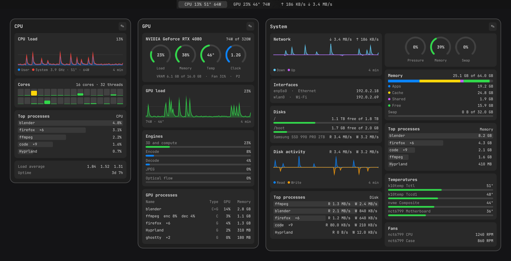

# OmaView

Live CPU, GPU and network stats in your [Omarchy](https://omarchy.org) bar. Hover a section for
a detailed report, and rearrange its cards however you like.



> [!WARNING]
> **Made by AI — use at your own peril.** I've reviewed the code, but that doesn't make it
> bulletproof. Expect sharp edges.

## Install

```bash
omarchy plugin add https://github.com/qnlbnsl/omaview.git --enable
```

Needs Python 3.11 or newer, with no extra packages. To update:

```bash
omarchy plugin update io.github.qnlbnsl.omaview
```

## GPU support

| GPU | Driver | Status |
|---|---|---|
| NVIDIA | Proprietary | Tested on an RTX 3090 |
| AMD | `amdgpu` | Not validated |
| Intel Arc | `xe` or `i915` | Not validated |

Have an AMD or Intel card? A quick
[validation report](https://github.com/qnlbnsl/omaview/issues/new?template=gpu_validation.yml)
would be a big help, even if everything looks right.

## Use

Rest the pointer on a section to open its report, or click it. Move along the bar to switch
reports, and move away to close.

System closes on its own if you cross it without stopping, so an accidental open doesn't get in
your way.

To rearrange a report, click its pencil:

| Control | What it does |
|---|---|
| `CPU load ›` | Switches the sensor the card shows |
| `S` / `M` / `L` | Changes the size |
| `↑` `↓` `←` `→` | Moves the card, including into a new column (up to three) |
| `✕` | Removes the card |
| **+ Add card** | Adds a card to that column |
| **Reset** | Restores the report's defaults |
| **Done** | Saves |

From a keybinding or script:

```bash
omarchy-shell omaview open cpu    # or gpu, system
omarchy-shell omaview edit
omarchy-shell omaview close
omarchy-shell shell toggle io.github.qnlbnsl.omaview '{}'
```

## Settings

Use Fahrenheit:

```bash
omarchy bar set io.github.qnlbnsl.omaview temperatureUnit Fahrenheit
```

To change hover behaviour, create `~/.config/omaview/config.json`. Anything you leave out uses
the default.

```json
{
  "openDelayMs": 300,
  "systemOpenDelayMs": 500,
  "closeOnPassThrough": true,
  "passThroughMs": 400
}
```

| Setting | What it does |
|---|---|
| `openDelayMs` | Hover time before CPU or GPU opens |
| `systemOpenDelayMs` | Hover time before System opens |
| `closeOnPassThrough` | Closes System if you cross it without stopping |
| `passThroughMs` | How long you can keep moving inside System before it closes |

## Remove

```bash
omarchy plugin remove io.github.qnlbnsl.omaview
```

To keep it installed but off the bar, use `omarchy plugin disable` with the same ID. Either one
clears your layouts and temperature unit. `~/.config/omaview` stays until you delete it.

## What it touches

- **Runs** one small Python collector, shared across monitors, and `hyprctl cursorpos` while a
  report is open.
- **Reads** `/proc`, `/sys`, your processes' open GPU files on AMD and Intel, NVIDIA's NVML
  library and your config file.
- **Writes** a socket and lock file in `$XDG_RUNTIME_DIR`, and your layouts to Omarchy's
  `shell.json`.
- **Doesn't** use the network, need root, install services or read process command lines.

## Limits

- Only one GPU is shown: NVIDIA first, then AMD or discrete Intel, then integrated graphics.
- Per-process disk rates cover only your own processes, as do AMD and Intel GPU per-process
  numbers.
- Intel load is added up from your own processes. Intel doesn't report total VRAM or fan
  percentage, and its encode and decode rows show the same number.
- A sleeping AMD or Intel GPU shows 0% and no sensor readings, because reading them would wake it.
- Graphs cover the last 4 minutes and restart with the bar.
- Vertical bars are untested.

## Development

See [docs/design.md](docs/design.md).

## License

[MIT](LICENSE)
